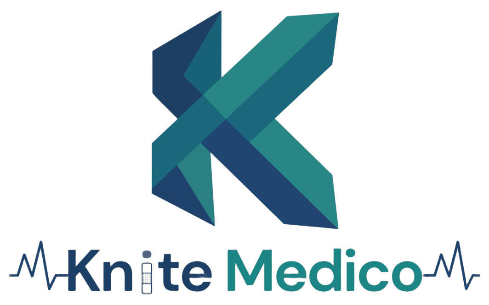
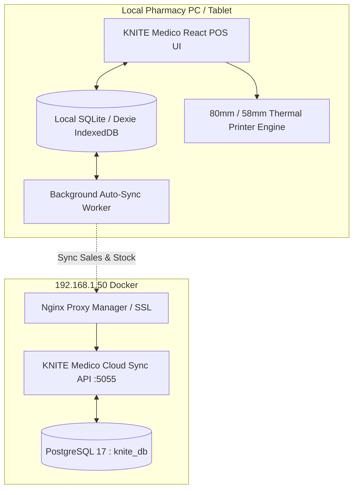

# 💊 KNITE Medico SaaS
### Offline-First Pharmacy Billing, Inventory & Multi-Platform SaaS



> **KNITE Medico** is a modern medical billing, inventory management, and pharmacy POS system built for medical shops and pharmacies.
> It uses an **offline-first local database** so billing never stops when internet drops, with an optional **Paid Cloud Sync** to your self-hosted KNITE server (`192.168.1.50`) for cloud backups, multi-device sync, and owner mobile monitoring.

---

## 🏗️ Architecture Overview



---

## 🌟 Key Features

* ⚡ **Lightning-Fast Keyboard-Driven POS**:
  * Autocomplete search by Brand Name, Salt/Generic Composition, or Barcode scanner.
  * Instant keyboard hotkeys: `F2` (New Sale), `F3` (Inventory), `F4` (Bills), `F5` (GST Analytics).
  * Multiple payment options: Cash, Dynamic UPI QR Code, Card, and Udhar/Credit ledger.
* 🧾 **80mm & 58mm Thermal Receipt Printing**:
  * Print-ready bills with pharmacy DL number, GSTIN, doctor name, patient details, batch/expiry breakdown.
* 💊 **Smart Medicine Inventory**:
  * Expiry tracking with color-coded badges (Red = Expired, Amber = Near Expiry in 60 days, Green = Good).
  * Low stock alerts.
  * **Generic Salt Matcher**: When a brand is out of stock, click to find substitute medicines with the identical chemical composition!
* 🔄 **Offline-First + Cloud Sync**:
  * Works 100% offline with zero lag.
  * Auto-syncs to your PostgreSQL database in the cloud whenever internet is connected.
* 📊 **Financial & GST Analytics**:
  * Daily revenue, Cash vs UPI collections, total inventory valuation, near-expiry risk valuation, and CGST/SGST tax filing summaries.
* 💰 **SaaS Subscription Monetization**:
  * **Free Offline Tier**: Unlimited billing and inventory on the local pharmacy PC.
  * **Pro Cloud Tier**: Cloud sync, multi-branch, remote mobile owner monitoring, and automated encrypted snapshots.

---

## 🚀 Quick Start (Running Locally)

### 1. Start the Cloud Sync Server
```bash
cd server
docker compose up -d
```
* The API runs at: `http://localhost:5055`
* Connects automatically to your existing PostgreSQL container (`knite_db`) on the Docker `backend` network.

### 2. Start the Client Web App
```bash
cd client
npm run dev
```
* Open in browser: `http://localhost:5173` or `http://192.168.1.50:5173`

Or start both with a single command:
```bash
./scripts/start-all.sh
```

---

## 💻 Packaging for Windows & Mac (Desktop App)

KNITE Medico is pre-configured with **Electron** and **electron-builder**.

1. **Test Desktop Mode Locally**:
   ```bash
   cd client
   npm run electron:dev
   ```

2. **Build Windows Installer (`.exe`)**:
   ```bash
   cd client
   npx electron-builder --win nsis
   ```
   * Output will be in `client/dist-electron/KNITE Medico Setup.exe`

3. **Build Mac Installer (`.dmg`)**:
   ```bash
   cd client
   npx electron-builder --mac dmg
   ```

---

## 📱 Packaging for Android (Google Play Store)

KNITE Medico is configured with **Capacitor** for Android:

1. **Build Web Assets & Sync**:
   ```bash
   cd client
   npm run build
   npx cap sync android
   ```

2. **Open in Android Studio**:
   ```bash
   npx cap open android
   ```
   * Click **Build > Generate Signed Bundle / APK** in Android Studio to create your Google Play Store `.aab` bundle!

---

## 🌐 Nginx Proxy Manager Setup (Reverse Proxy & SSL)

In your existing Nginx Proxy Manager at `http://192.168.1.50:81`:

1. Click **Proxy Hosts > Add Proxy Host**
2. **Domain Names**: `medico.kniteinfotech.com` (or your chosen domain/subdomain)
3. **Scheme**: `http`
4. **Forward Hostname / IP**: `knite-medico-backend` (Direct container DNS on `backend` network!)
5. **Forward Port**: `5055`
6. **Block Common Exploits**: Enabled
7. **SSL**: Request a new SSL Certificate (Let's Encrypt) with Force SSL enabled.

---

## 📁 Repository Structure

```
Medical saas/
├── client/                     # Frontend POS, Desktop & Mobile App
│   ├── android/                # Native Android Studio Project (Capacitor)
│   ├── electron/               # Electron desktop main & preload scripts
│   ├── src/
│   │   ├── components/         # POSBilling, Inventory, Invoices, Reports, ThermalReceipt
│   │   ├── db/                 # Dexie.js offline-first local database
│   │   └── services/           # Cloud Sync & Backup service
│   ├── capacitor.config.json   # Android Play Store configuration
│   └── package.json            # Electron & web dependencies
├── server/                     # Cloud Backend API (Node.js & Express)
│   ├── src/
│   │   ├── routes/             # auth, sync, backup, analytics
│   │   ├── db.js               # PostgreSQL connection pool & migrations
│   │   └── server.js           # Express API server
│   ├── Dockerfile              # Production container definition
│   └── compose.yml             # Docker compose deployment
├── scripts/                    # Helper scripts for startup & builds
│   ├── start-all.sh
│   ├── build-desktop.sh
│   └── build-android.sh
└── README.md
```
